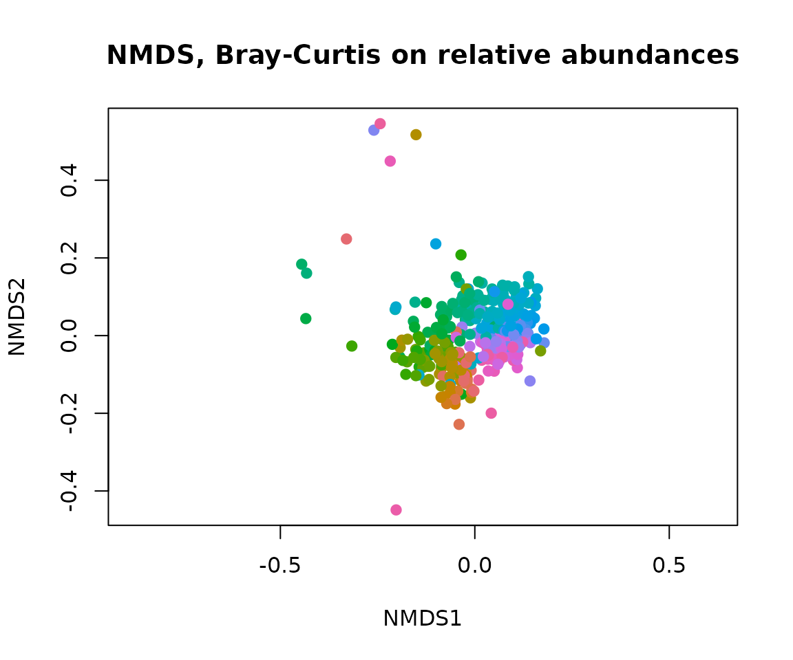
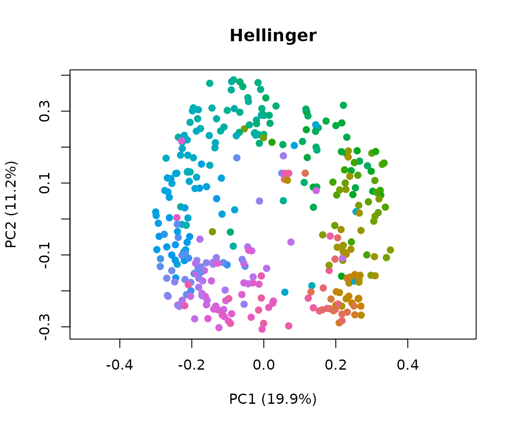
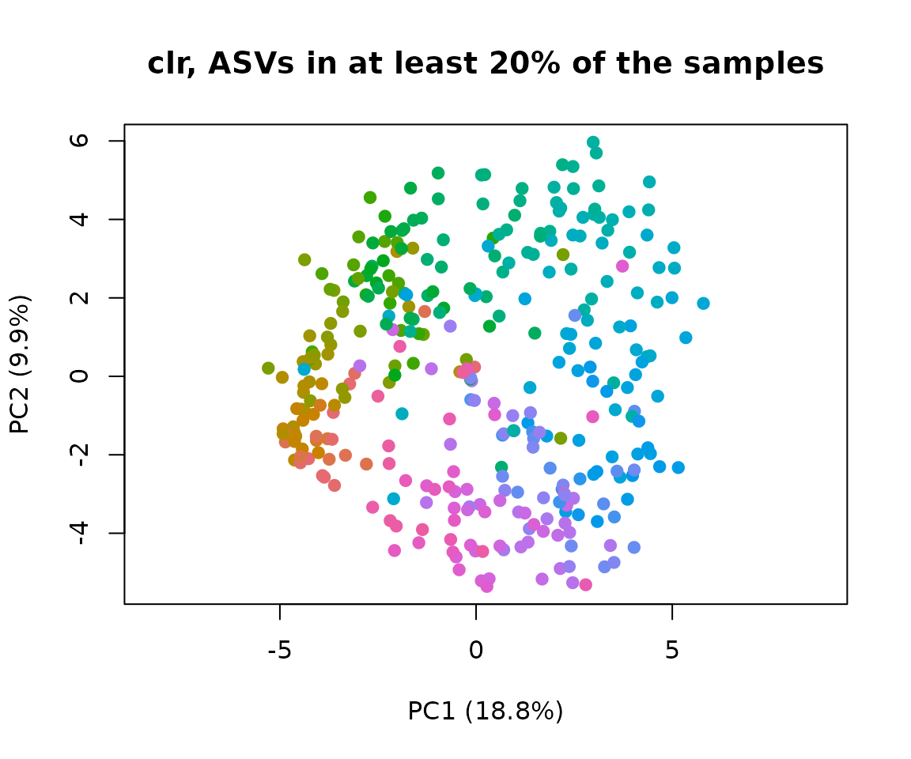
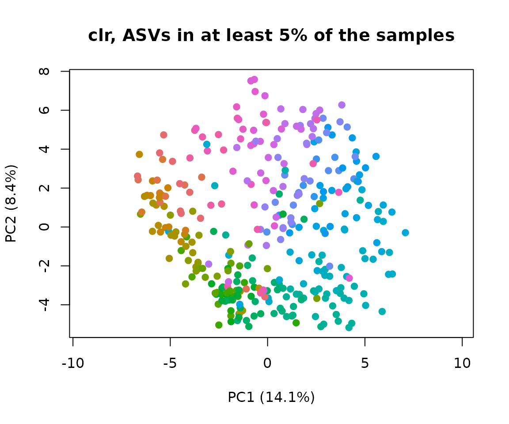
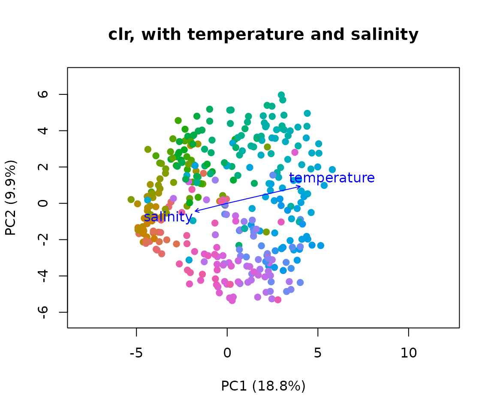
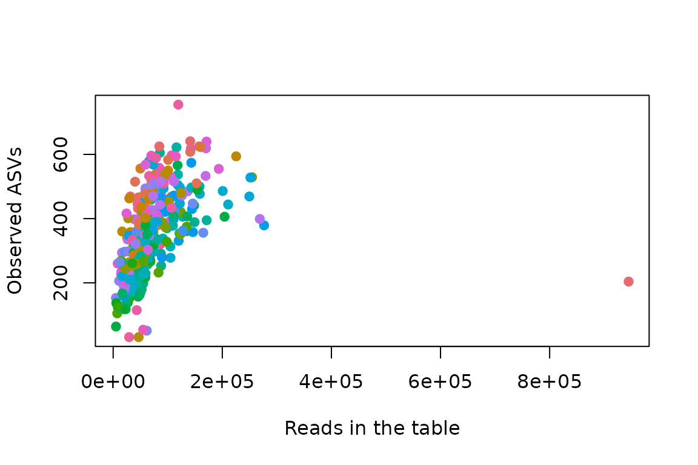
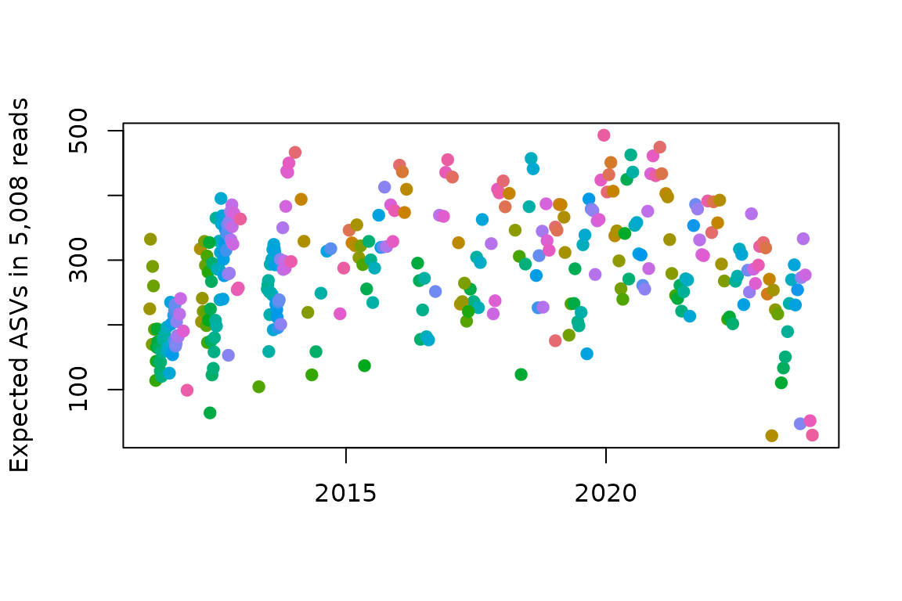

# A seasonal time series of ASVs, from the published table to an ordination

This vignette follows one dataset from the file you download to an
ordination. The data is the 16S time series from the Linnaeus Microbial
Observatory (LMO) in the Baltic Sea, 2011–2023, published through the
[Swedish ASV portal](https://asv-portal.biodiversitydata.se/) and GBIF.
It was sampled about every two weeks, so the community should go round a
seasonal cycle each year. That is what we look for in the ordinations.

``` r

library(duckplyr)
library(ecolongr)
```

## The data

The dataset is
[`lmo_2011-2023_16s`](https://www.gbif.se/ipt/resource?r=lmo_2011-2023_16s)
on the GBIF IPT of the Swedish node. Its Darwin Core archive (109 MB
zipped, 1.1 GB unpacked) holds 405,592 occurrences: one row per ASV and
sample, with the read count in `organismQuantity`. The same measurements
table has the temperature and, for most samples, the salinity. It has
two size fractions of the water, stored as the measurement
`filter_fraction` in `extendedmeasurementorfact.txt`: `3` (particle
associated, trapped on a 3 µm filter) and `3-0.2` (free living, trapped
on a 0.2 µm filter after the 3 µm one).

The archive has the layout of GBIF’s standard Darwin Core archives, not
that of the ZIP files the `asvoccur` package reads, so we read it
directly. `duckplyr` reads the tab-separated files without loading them
into R, and the filtering stays lazy:

``` r

download.file("https://www.gbif.se/ipt/archive.do?r=lmo_2011-2023_16s", "lmo.zip", mode = "wb")
unzip("lmo.zip", exdir = "lmo")

tsv <- list(delim = "\t", quote = "", header = TRUE)
occurrence <- read_csv_duckdb("lmo/occurrence.txt", options = tsv, prudence = "stingy")

# all_varchar: the first rows of the measurements are numbers (temperature, salinity),
# which would make DuckDB read the whole column as numeric.
emof <- read_csv_duckdb("lmo/extendedmeasurementorfact.txt",
                        options = c(tsv, list(all_varchar = TRUE)), prudence = "stingy")

free_living <- emof |>
  filter(measurementType == "filter_fraction", measurementValue == "3-0.2") |>
  select(occurrenceID)

counts <- occurrence |>
  semi_join(free_living, by = "occurrenceID") |>
  transmute(sample = eventID, taxon = taxonID, quant = organismQuantity)

metadata <- occurrence |>
  semi_join(free_living, by = "occurrenceID") |>
  distinct(sample = eventID, date = eventDate, depth = minimumDepthInMeters) |>
  as.data.frame()
```

That is 162,171 rows, 347 samples and 24,286 ASVs. `prudence = "stingy"`
makes `duckplyr` stop with an error if it would otherwise copy a whole
table into R.

To keep the vignette fast, the package contains a smaller version of the
same table: the free-living fraction, with only the ASVs present in at
least 5% of the samples (`data-raw/make_lmo_extdata.R` makes it from the
archive, with the temperature and salinity of each sample). The rest of
the vignette uses it.

``` r

counts <- read_csv_duckdb(
  system.file("extdata", "lmo_free_living.tsv.gz", package = "ecolongr"),
  options = list(delim = "\t", header = TRUE), prudence = "stingy"
)
#> duckdb keeps downloaded extensions and secrets in a temporary directory:
#> ℹ /tmp/RtmpTsBCRB/duckdb
#> This is removed when the R session ends.
#> • Extensions are re-downloaded each session.
#> • Secrets are lost.
#> ℹ Run duckdb(shared_home = TRUE) (or create ~/.duckdb) to keep them (suitable for most users).
#> ℹ Run duckdb(shared_home = FALSE) to accept the temporary directory (and silence this message).
#> ℹ See ?duckdb_storage for details and alternatives.
metadata <- read.delim(system.file("extdata", "lmo_free_living_samples.tsv", package = "ecolongr"))
metadata$date <- as.Date(metadata$date)
metadata$day_of_year <- as.integer(format(metadata$date, "%j"))
metadata$month <- factor(format(metadata$date, "%m"))

counts |> summarise(rows = n(), samples = n_distinct(sample), taxa = n_distinct(taxon)) |> as.data.frame()
#>     rows samples taxa
#> 1 120187     347 1441
```

## Filtering

The filters are `duckplyr` verbs, so the table is still not in R. The
depth of a sample is its number of reads in the table.

``` r

depth <- counts |> summarise(reads = sum(quant, na.rm = TRUE), .by = sample)
summary(as.data.frame(depth)$reads)
#>    Min. 1st Qu.  Median    Mean 3rd Qu.    Max. 
#>     743   35280   58384   71479   89350  944762
```

We drop the samples with fewer than 5,000 reads, and later the ASVs that
occur in fewer than 20% of the samples. `duckplyr` does not translate
`filter(sample %in% vector)` for a vector of this length, so we filter
with a join, as in the README.
[`el_vegdist()`](https://biodiversitydata-se.github.io/ecolongr/reference/el_vegdist.md)
and
[`el_rda()`](https://biodiversitydata-se.github.io/ecolongr/reference/el_rda.md)
can only see the samples that have rows, so we pass the sample table as
`samples`: it sets the order of the results to the order of the
metadata, which `adonis2()` and `envfit()` rely on.

``` r

deep <- depth |> filter(reads >= 5000) |> select(sample)
counts <- counts |> semi_join(deep, by = "sample")

metadata <- metadata[metadata$sample %in% as.data.frame(deep)$sample, ]
nrow(metadata)
#> [1] 335
```

## Colouring by season

The axis labels of a PCA give the percentage of the total variance of
the table that the axis holds: the eigenvalue divided by `tot.chi`, not
by the sum of the kept eigenvalues. We colour the samples by day of
year, with a palette that returns to its start, so that a seasonal cycle
shows as a ring with the colours in order.

``` r

season_colours <- function(day) hcl(h = 360 * day / 366, c = 90, l = 60)

plot_season <- function(ordination, main, ...) {
  sites <- vegan::scores(ordination, display = "sites", choices = 1:2)
  axes <- colnames(sites)
  if (inherits(ordination, "rda")) {
    percent <- 100 * vegan::eigenvals(ordination)[1:2] / ordination$tot.chi
    axes <- sprintf("%s (%.1f%%)", axes, percent)
  }
  plot(sites, col = season_colours(metadata$day_of_year), pch = 19, asp = 1, main = main,
       xlab = axes[1], ylab = axes[2], ...)
}
```

## Hellinger distances

Hellinger standardisation followed by Euclidean distance is a common
choice for amplicon counts.
[`el_decostand()`](https://biodiversitydata-se.github.io/ecolongr/reference/el_decostand.md)
does the standardisation lazily, and
[`el_vegdist()`](https://biodiversitydata-se.github.io/ecolongr/reference/el_vegdist.md)
runs the query:

``` r

d_hellinger <- counts |>
  el_decostand("hellinger") |>
  el_vegdist("euclidean", samples = metadata$sample)
#> duckdb keeps downloaded extensions and secrets in a temporary directory:
#> ℹ /tmp/RtmpTsBCRB/duckdb
#> This is removed when the R session ends.
#> • Extensions are re-downloaded each session.
#> • Secrets are lost.
#> ℹ Run duckdb(shared_home = TRUE) (or create ~/.duckdb) to keep them (suitable for most users).
#> ℹ Run duckdb(shared_home = FALSE) to accept the temporary directory (and silence this message).
#> ℹ See ?duckdb_storage for details and alternatives.
class(d_hellinger)
#> [1] "dist"
attr(d_hellinger, "Size")
#> [1] 335
```

The result is a `dist`, so `vegan` takes over:

``` r

set.seed(1)
vegan::adonis2(d_hellinger ~ month, data = metadata, permutations = 199)
#> Permutation test for adonis under reduced model
#> Permutation: free
#> Number of permutations: 199
#> 
#> vegan::adonis2(formula = d_hellinger ~ month, data = metadata, permutations = 199)
#>           Df SumOfSqs      R2      F Pr(>F)   
#> Model     11   47.316 0.30173 12.688  0.005 **
#> Residual 323  109.499 0.69827                 
#> Total    334  156.816 1.00000                 
#> ---
#> Signif. codes:  0 '***' 0.001 '**' 0.01 '*' 0.05 '.' 0.1 ' ' 1
```

## Bray–Curtis distances and NMDS

Non-metric multidimensional scaling (NMDS) uses only the ranks of the
distances, so it needs no elaborate transformation. A common choice is
Bray–Curtis distance on relative abundances. `el_decostand("total")`
makes the relative abundances, and
[`vegan::metaMDS()`](https://vegandevs.github.io/vegan/reference/metaMDS.html)
takes the `dist`. Given a `dist`, `metaMDS()` has no species scores and
does no transformation of its own, which it would do for a community
matrix; that matrix is what this package avoids building.

``` r

d_bray <- counts |>
  el_decostand("total") |>
  el_vegdist("bray", samples = metadata$sample)
#> duckdb keeps downloaded extensions and secrets in a temporary directory:
#> ℹ /tmp/RtmpTsBCRB/duckdb
#> This is removed when the R session ends.
#> • Extensions are re-downloaded each session.
#> • Secrets are lost.
#> ℹ Run duckdb(shared_home = TRUE) (or create ~/.duckdb) to keep them (suitable for most users).
#> ℹ Run duckdb(shared_home = FALSE) to accept the temporary directory (and silence this message).
#> ℹ See ?duckdb_storage for details and alternatives.

set.seed(1)
nmds <- vegan::metaMDS(d_bray, k = 2, trace = 0, trymax = 10)
nmds$stress
#> [1] 0.1607563
plot_season(nmds, "NMDS, Bray-Curtis on relative abundances")
```



The seasons are ordered along the cloud, but a few samples lie far from
the rest and compress the view.

## Principal components

[`el_rda()`](https://biodiversitydata-se.github.io/ecolongr/reference/el_rda.md)
computes the first axes of a PCA without making the dense table.

``` r

pca_hellinger <- counts |>
  el_decostand("hellinger") |>
  el_rda(k = 5, samples = metadata$sample)
#> duckdb keeps downloaded extensions and secrets in a temporary directory:
#> ℹ /tmp/RtmpTsBCRB/duckdb
#> This is removed when the R session ends.
#> • Extensions are re-downloaded each session.
#> • Secrets are lost.
#> ℹ Run duckdb(shared_home = TRUE) (or create ~/.duckdb) to keep them (suitable for most users).
#> ℹ Run duckdb(shared_home = FALSE) to accept the temporary directory (and silence this message).
#> ℹ See ?duckdb_storage for details and alternatives.
#> `el_rda()`: the first 5 axes hold 48.5% of the total variance and 51.5% is left out. Use `summary()` for the share of each axis.

plot_season(pca_hellinger, "Hellinger")
```



``` r

summary(pca_hellinger)$cont$importance[2:3, 1:3]
#>                             PC1       PC2        PC3
#> Proportion Explained  0.1987996 0.1115681 0.06577976
#> Cumulative Proportion 0.1987996 0.3103677 0.37614745
```

The colours follow each other around a ring, one lap per year, so the
seasonal cycle is the main structure in the first two axes.

## The centred log-ratio

The Aitchison distance is the Euclidean distance on the centred
log-ratio (clr) of the counts. Zeros need a pseudocount. A pseudocount
of `1 / (the sample's reads)` in each sample lets a shallow sample, with
its higher detection limit, get a larger pseudocount. Give the raw
counts: the pseudocount is in count units.
`pseudocount = "inverse_depth"` takes the reads from the table it is
given, so we compute the depths from the whole table first and pass them
by name, because we filter the ASVs below.

`clr` makes every cell non-zero, so it is not a method of
[`el_decostand()`](https://biodiversitydata-se.github.io/ecolongr/reference/el_decostand.md).
It is computed from the counts inside the two functions that use it, and
the dense table is never built. `el_vegdist(method = "aitchison")`
returns the Aitchison distance, and `el_rda(transform = "clr")` is a PCA
of the clr, whose sample distances in all axes are the same Aitchison
distances.

On amplicon data, the many rare ASVs dominate a clr unless they are
removed. We keep the ASVs present in at least 20% of the samples:

``` r

n_samples <- nrow(metadata)

depth <- counts |>
  summarise(total = sum(quant, na.rm = TRUE), .by = sample) |>
  as.data.frame()
pseudocount <- setNames(1 / depth$total, depth$sample)

common <- counts |>
  summarise(prevalence = n_distinct(sample), .by = taxon) |>
  filter(prevalence >= 0.2 * n_samples) |>
  select(taxon)

common |> summarise(taxa = n()) |> as.data.frame()
#>   taxa
#> 1  567

counts_common <- counts |> semi_join(common, by = "taxon")
```

``` r

d_aitchison <- counts_common |>
  el_vegdist("aitchison", pseudocount = pseudocount, samples = metadata$sample)
#> duckdb keeps downloaded extensions and secrets in a temporary directory:
#> ℹ /tmp/RtmpTsBCRB/duckdb
#> This is removed when the R session ends.
#> • Extensions are re-downloaded each session.
#> • Secrets are lost.
#> ℹ Run duckdb(shared_home = TRUE) (or create ~/.duckdb) to keep them (suitable for most users).
#> ℹ Run duckdb(shared_home = FALSE) to accept the temporary directory (and silence this message).
#> ℹ See ?duckdb_storage for details and alternatives.

pca_clr <- counts_common |>
  el_rda(k = 5, transform = "clr", pseudocount = pseudocount, samples = metadata$sample)
#> duckdb keeps downloaded extensions and secrets in a temporary directory:
#> ℹ /tmp/RtmpTsBCRB/duckdb
#> This is removed when the R session ends.
#> • Extensions are re-downloaded each session.
#> • Secrets are lost.
#> ℹ Run duckdb(shared_home = TRUE) (or create ~/.duckdb) to keep them (suitable for most users).
#> ℹ Run duckdb(shared_home = FALSE) to accept the temporary directory (and silence this message).
#> ℹ See ?duckdb_storage for details and alternatives.
#> `el_rda()`: the first 5 axes hold 39.8% of the total variance and 60.2% is left out. Use `summary()` for the share of each axis.

plot_season(pca_clr, "clr, ASVs in at least 20% of the samples")
```



``` r

summary(pca_clr)$cont$importance[2:3, 1:3]
#>                             PC1        PC2        PC3
#> Proportion Explained  0.1878552 0.09937606 0.04375883
#> Cumulative Proportion 0.1878552 0.28723123 0.33099005
```

The cycle is there as well, as a filled disc rather than a thin ring.

For comparison, the same PCA with all the ASVs of the bundled table
(those in at least 5% of the samples):

``` r

pca_clr_all <- counts |>
  el_rda(k = 5, transform = "clr", pseudocount = pseudocount, samples = metadata$sample)
#> duckdb keeps downloaded extensions and secrets in a temporary directory:
#> ℹ /tmp/RtmpTsBCRB/duckdb
#> This is removed when the R session ends.
#> • Extensions are re-downloaded each session.
#> • Secrets are lost.
#> ℹ Run duckdb(shared_home = TRUE) (or create ~/.duckdb) to keep them (suitable for most users).
#> ℹ Run duckdb(shared_home = FALSE) to accept the temporary directory (and silence this message).
#> ℹ See ?duckdb_storage for details and alternatives.
#> `el_rda()`: the first 5 axes hold 33.3% of the total variance and 66.7% is left out. Use `summary()` for the share of each axis.

plot_season(pca_clr_all, "clr, ASVs in at least 5% of the samples")
```



With the ASVs that occur in 5–20% of the samples included, the points
spread out more and the order of the colours is less clear.

## Environmental variables

The temperature and the salinity of each sample are in `metadata`.
[`vegan::envfit()`](https://vegandevs.github.io/vegan/reference/envfit.html)
fits them to the ordination, as arrows in the plot, and gives the share
of variation each explains and a permutation p-value. Samples without a
salinity are dropped with `na.rm = TRUE`.

``` r

env <- metadata[, c("temperature", "salinity")]

set.seed(3)
fit <- vegan::envfit(pca_clr, env, choices = 1:2, permutations = 199, na.rm = TRUE)
fit
#> 
#> ***VECTORS
#> 
#>                  PC1      PC2     r2 Pr(>r)   
#> temperature  0.97426  0.22542 0.6817  0.005 **
#> salinity    -0.97086 -0.23964 0.1318  0.005 **
#> ---
#> Signif. codes:  0 '***' 0.001 '**' 0.01 '*' 0.05 '.' 0.1 ' ' 1
#> Permutation: free
#> Number of permutations: 199
#> 
#> 20 observations deleted due to missingness

plot_season(pca_clr, "clr, with temperature and salinity", xlim = c(-8, 12))
plot(fit, add = TRUE, arrow.mul = 5)
```



Temperature lies along the first axis and explains much more of the
variation (`r2`) than salinity, which points the other way.

## How much do the axes leave out?

[`el_rda()`](https://biodiversitydata-se.github.io/ecolongr/reference/el_rda.md)
keeps the first `k` axes. The total variance of the table is still
known, so the share that the other axes hold can be computed:

``` r

unexplained <- function(pca) 1 - sum(vegan::eigenvals(pca)) / pca$tot.chi
round(c(hellinger = unexplained(pca_hellinger), clr = unexplained(pca_clr)), 2)
#> hellinger       clr 
#>      0.52      0.60
```

The share of an axis is its eigenvalue divided by the total variance,
`tot.chi`, which [`summary()`](https://rdrr.io/r/base/summary.html)
does. Dividing by the sum of the kept eigenvalues is wrong. Those shares
sum to one over the `k` axes whatever `k` is, so they hide what the
other axes hold:

``` r

eig <- vegan::eigenvals(pca_clr)
round(rbind(
  right = eig / pca_clr$tot.chi,
  wrong = eig / sum(eig)
), 3)
#>         PC1   PC2   PC3   PC4   PC5
#> right 0.188 0.099 0.044 0.041 0.026
#> wrong 0.472 0.250 0.110 0.104 0.064
```

## Seasonal structure in the distances

A distance matrix is what
[`vegan::adonis2()`](https://vegandevs.github.io/vegan/reference/adonis.html)
needs. The month explains this share of the variation in each distance:

``` r

set.seed(2)
r2 <- sapply(
  list(hellinger = d_hellinger, aitchison = d_aitchison),
  function(d) vegan::adonis2(d ~ month, data = metadata, permutations = 99)$R2[1]
)
round(r2, 2)
#> hellinger aitchison 
#>      0.30      0.26
```

## Alpha diversity

The same table gives the diversity of each sample.
[`el_specnumber()`](https://biodiversitydata-se.github.io/ecolongr/reference/el_diversity.md)
and
[`el_diversity()`](https://biodiversitydata-se.github.io/ecolongr/reference/el_diversity.md)
return one value per sample, named by sample, and the metadata joins on
the name:

``` r

richness <- el_specnumber(counts)
shannon <- el_diversity(counts, "shannon")

reads <- counts |>
  summarise(reads = sum(quant, na.rm = TRUE), .by = sample) |>
  as.data.frame()

alpha <- tibble(sample = names(shannon), shannon = shannon, richness = richness[sample]) |>
  left_join(metadata, by = "sample") |>
  left_join(reads, by = "sample")
head(alpha[, c("sample", "date", "reads", "richness", "shannon")])
#> # A tibble: 6 × 5
#>   sample                        date        reads richness shannon
#>   <chr>                         <date>      <dbl>    <int>   <dbl>
#> 1 LMO_2011-2023_16S:P10353_1017 2017-05-23 204223      406    4.16
#> 2 LMO_2011-2023_16S:P10353_1018 2017-06-15 135043      361    3.41
#> 3 LMO_2011-2023_16S:P10353_1019 2017-06-20 121584      354    3.81
#> 4 LMO_2011-2023_16S:P10353_1020 2017-07-06 109191      433    4.02
#> 5 LMO_2011-2023_16S:P10353_1021 2017-07-19 104947      313    3.43
#> 6 LMO_2011-2023_16S:P10353_1022 2017-08-01 210718      444    4.27
```

Richness grows with the number of reads, so a deep sample looks richer
than a shallow one.

``` r

plot(alpha$reads, alpha$richness, pch = 19, col = season_colours(alpha$day_of_year),
     xlab = "Reads in the table", ylab = "Observed ASVs")
```



[`el_rarefy()`](https://biodiversitydata-se.github.io/ecolongr/reference/el_drarefy.md)
gives the richness each sample is expected to have in a subsample of a
common number of reads. It is exact, with no random numbers, and equals
[`vegan::rarefy()`](https://vegandevs.github.io/vegan/reference/rarefy.html).
At the depth of the shallowest sample the samples are comparable, and
richness over time can be read:

``` r

common_depth <- min(alpha$reads)
alpha$expected <- el_rarefy(counts, common_depth)[alpha$sample]

plot(alpha$date, alpha$expected, pch = 19, col = season_colours(alpha$day_of_year),
     xlab = "", ylab = sprintf("Expected ASVs in %s reads", format(common_depth, big.mark = ",")))
```



[`el_drarefy()`](https://biodiversitydata-se.github.io/ecolongr/reference/el_drarefy.md)
gives, for each ASV in each sample, the probability that it is in such a
subsample, as a lazy table.
[`el_rrarefy()`](https://biodiversitydata-se.github.io/ecolongr/reference/el_rrarefy.md)
draws one random subsample instead and returns it as a table, for
analyses that need counts at equal depth.

A model of how many ASVs a sample has not yet shown needs the number of
ASVs seen once, twice and so on.
[`el_frequency_counts()`](https://biodiversitydata-se.github.io/ecolongr/reference/el_frequency_counts.md)
computes that for every sample in one lazy step:

``` r

frequencies <- counts |> el_frequency_counts() |> as.data.frame()
frequencies |> filter(sample == metadata$sample[1]) |> head()
#>                         sample count n_taxa
#> 1 LMO_2011-2023_16S:P2256_1001    37      2
#> 2 LMO_2011-2023_16S:P2256_1001    22      5
#> 3 LMO_2011-2023_16S:P2256_1001   132      2
#> 4 LMO_2011-2023_16S:P2256_1001    52      3
#> 5 LMO_2011-2023_16S:P2256_1001   180      1
#> 6 LMO_2011-2023_16S:P2256_1001    81      2
```

The `breakaway` package fits such models to one sample at a time; the
help page of
[`el_frequency_counts()`](https://biodiversitydata-se.github.io/ecolongr/reference/el_frequency_counts.md)
shows how to run it on this table in parallel with `purrr`.

## Memory

Nothing above held the table as a dense matrix. For the full table the
distance matrix is the largest object (one number per pair of samples),
and the rest of the work is done in batches. See the README for settings
and measurements on much larger tables.
